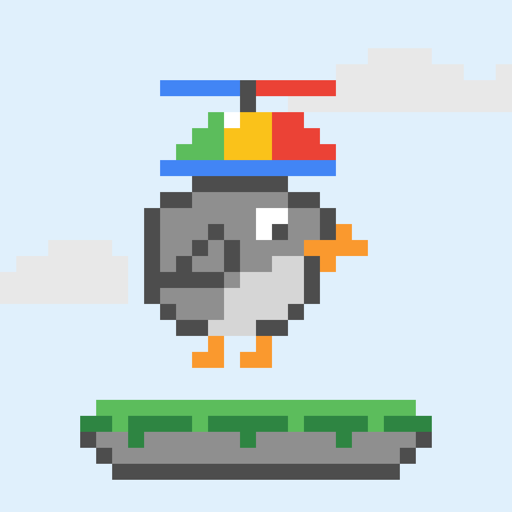
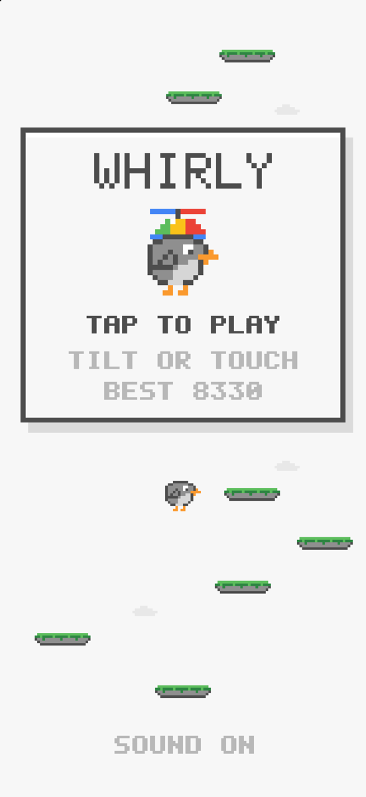
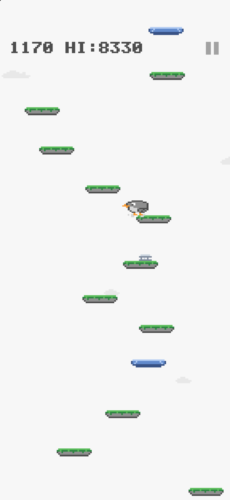
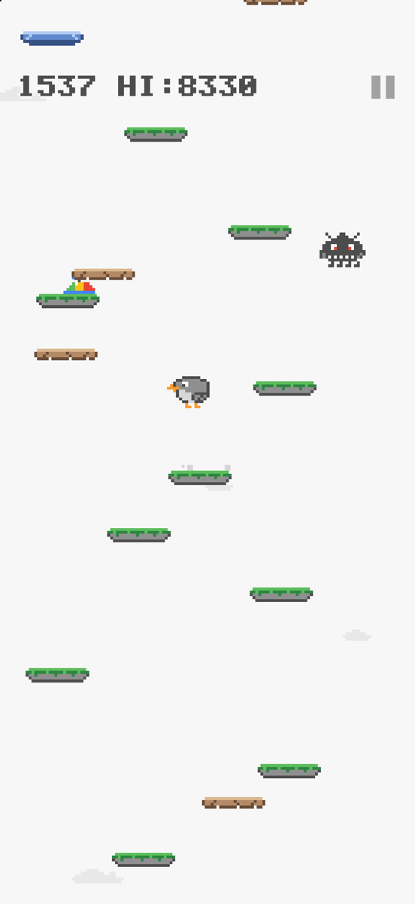
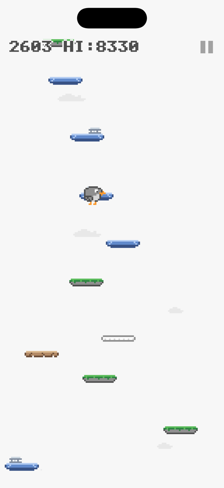

# Whirly



A one-thumb vertical bouncer for iPhone, made in the spirit of **WhirlyBird**, the little Play Games arcade game that quietly disappeared. Your bird bounces on its own; you steer it as high as it can go.

Native SwiftUI, no dependencies, no ads, no network. All art is original pixel art drawn in code.

<p align="center">
  
  
  
  
</p>

## How to play

- **Steer** by tilting the phone, or hold the left or right half of the screen. Holding wins over tilt.
- The screen **wraps around**: fly off one side and you come back on the other.
- Fall off the bottom and the run is over. Your best score is saved.
- Pause with the ‖ button at the top right. The game also pauses itself when you leave the app.

| Thing | What it does |
|---|---|
| Mossy stone platform | A normal bounce |
| Blue platform | Slides from side to side |
| Cracked clay platform | Crumbles when you land, so you fall through |
| White glass platform | Works once, then vanishes |
| Spring | Launches you about three times higher |
| Propeller hat | Flies you straight up for 3.5 seconds and knocks monsters away |
| Monster | Turns up past about 1,500 points. Stomp it from above; touch it any other way and you fall |

The level is generated as you climb and gets harder with height: gaps widen, and more platforms move, crumble or vanish. Every gap on the main path is always jumpable; crumbling platforms are only ever decoys placed between real steps.

## Build and run

Requirements: Xcode 26 or later, iOS 17 or later.

1. Open `Whirly.xcodeproj`.
2. In the Whirly target's **Signing & Capabilities**, choose your own team (a free Apple ID works) and, if needed, change the bundle identifier.
3. Pick a simulator or your iPhone and press Run.

To install a Release build on a connected iPhone from the terminal:

```bash
./install.sh <device-udid>
```

Find the UDID with `xcrun devicectl list devices`. With a free Apple ID the app stays signed for 7 days; run the script again to renew.

Debug builds accept `-autopilot` as a launch argument, which lets the bird climb on its own. It's handy for checking the higher levels.

## How it's built

| File | What's in it |
|---|---|
| `Whirly/Game.swift` | The model: fixed 60 Hz physics, platform generation, pickups, monsters, particles, scoring |
| `Whirly/Renderer.swift` | Draws each frame into a SwiftUI `Canvas`, snapped to device pixels so the pixel art stays crisp |
| `Whirly/Pixels.swift` | Palette, sprites as character grids, and the 5 × 7 pixel font |
| `Whirly/GameView.swift` | The screen, a UIKit multi-touch layer, tilt via Core Motion, haptics and the `CADisplayLink` clock |
| `Whirly/Sound.swift` | A one-voice square-wave beeper on `AVAudioEngine` that follows the silent switch |

## Credits

Not affiliated with or endorsed by Google. WhirlyBird was a Google Play Games title; this is an independent fan remake with its own code and art.
